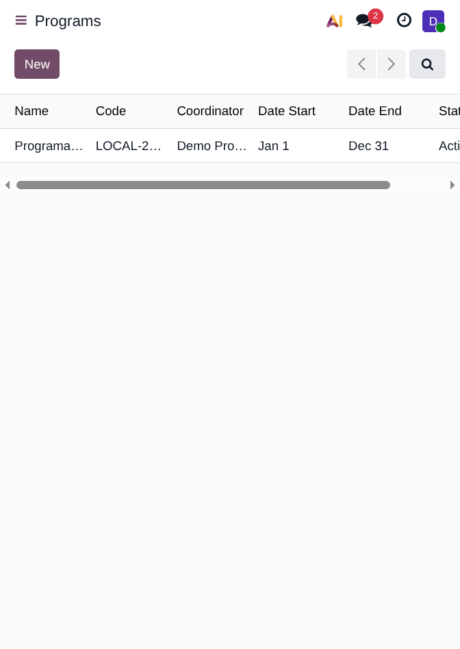
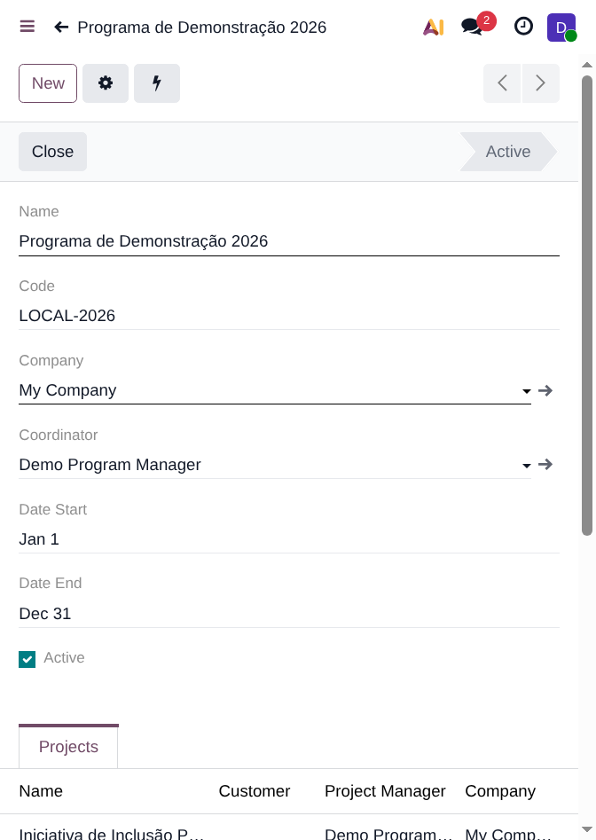
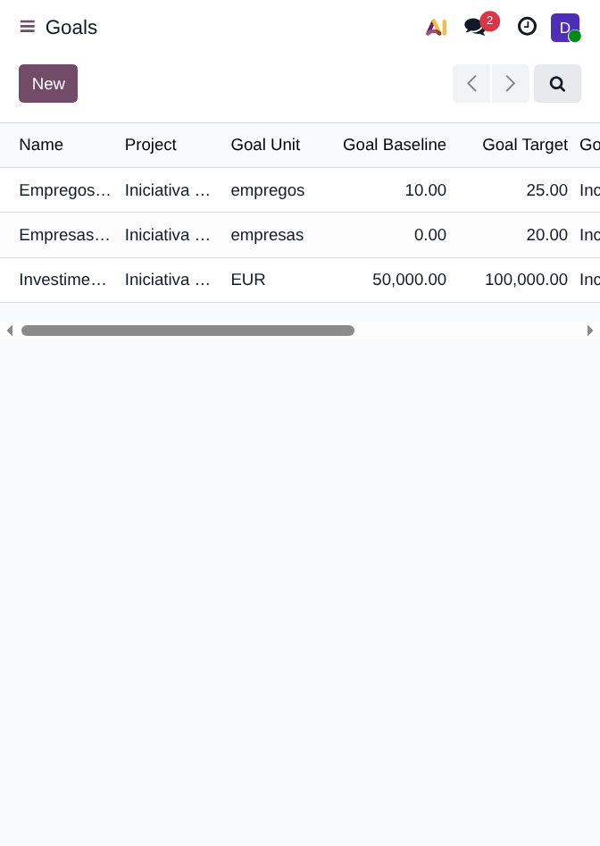
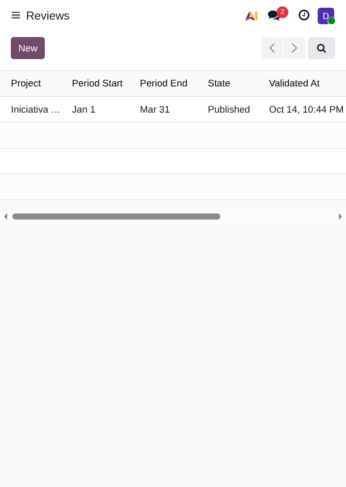
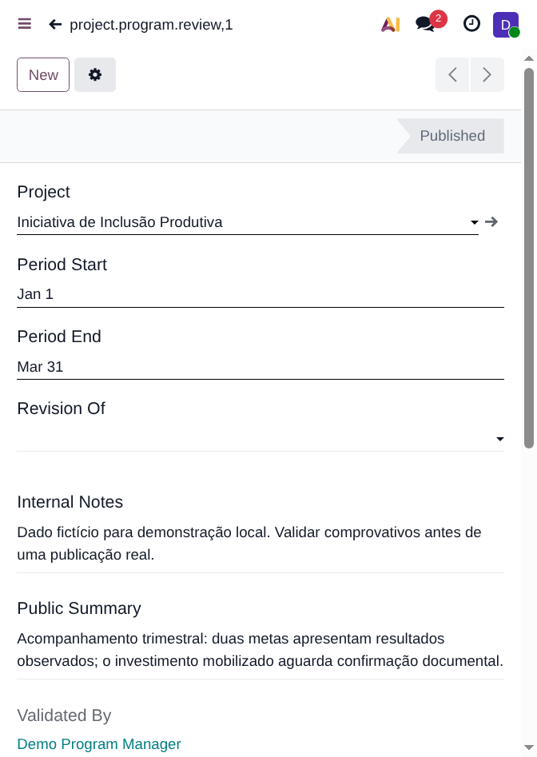
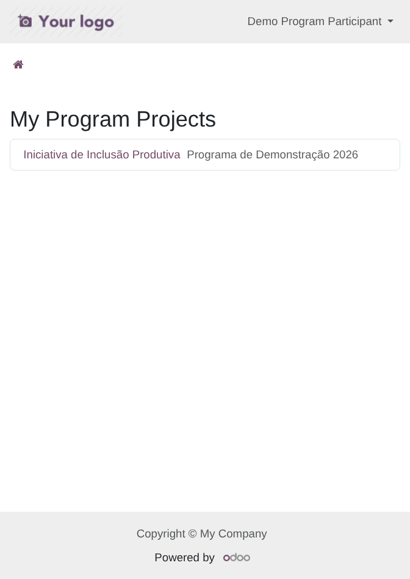
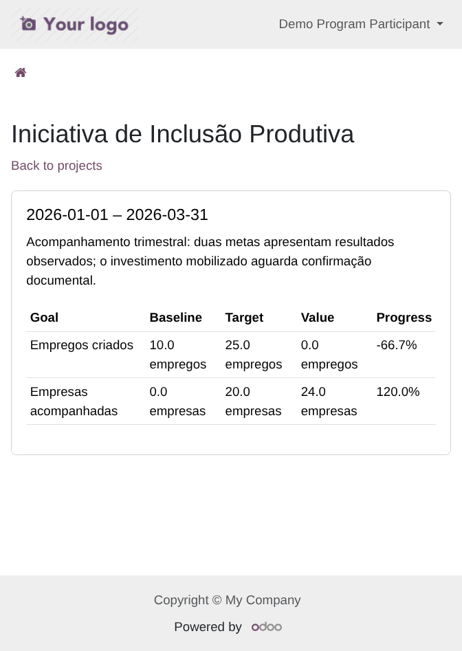

# Project Program: Local Odoo E2E Report

**Execution date:** 14 October 2026
**Status:** Local install, seeded demo, manager and portal browser flows verified
**Target:** Odoo 19.0 Community + Enterprise addons, local PostgreSQL, fictional data only

## Executive Summary

The `project_program` addon is installed and running at [http://127.0.0.1:8069](http://127.0.0.1:8069) against the dedicated `project_program_local` database. The local runner is bound to loopback, filters HTTP requests to this database, and starts with cron workers disabled. The test suite uses its own `project_program_test_local` database and a separate HTTP port.

The scenario demonstrates an active program, a linked project, three differently-shaped numeric goals, two validated measurements, one published quarterly review, a completed session and one individual portal membership. The portal participant sees only the assigned project and its published summary/validated values; internal notes and evidence notes are absent. Seven screenshots below were captured from the running browser session.

## Environment and Data

| Item | Value |
|---|---|
| Odoo | 19.0, sourced from the neighboring `Codoo` workspace checkout |
| Addon | `project_program` from this repository |
| Demo database | `project_program_local` |
| Test database | `project_program_test_local` |
| Web URL | `http://127.0.0.1:8069` |
| Demo program | `LOCAL-2026`, Programa de Demonstração 2026 |
| Demo project | Iniciativa de Inclusão Produtiva |
| Seeded records | 1 program, 1 membership, 3 goals, 1 published review, 2 validated measurements, 1 completed session |
| Accounts | Fictional manager and portal participant; generated passwords kept in ignored `.local/demo_accounts.json` (mode `0600`) |

The seed script is idempotent and refuses to run unless the active database is exactly `project_program_local`. It does not delete databases or records. The manager performs addon model operations through normal ACLs; elevated access is scoped to creating the standard Odoo Project record, which requires Project Administrator rights.

## Use Cases

| ID | Role | Scenario | Expected result | Observed result |
|---|---|---|---|---|
| UC-01 | Program Manager | Open Programs and inspect `LOCAL-2026` | Active program with coordinator, dates and linked project | Pass; program and project visible |
| UC-02 | Program Manager | Review goal progress | Values reflect validated measurements, including zero and above-target outcomes | Pass: 0/10 jobs produced -66.7%; 24/20 businesses assisted produced 120%; EUR goal remains unmeasured |
| UC-03 | Program Manager | Inspect quarterly review | Published status, audit timestamps and associated validated measurements | Pass; review published with two validated measurements |
| UC-04 | Portal participant | Open My Program Projects | Only explicitly assigned project is listed | Pass; one project listed |
| UC-05 | Portal participant | Open project details | Published summary, measured values and progress are shown | Pass; HTTP 200 and both measured indicators render |
| UC-06 | Portal participant | Inspect private review/evidence content | Internal notes and evidence notes are not returned | Pass; browser content assertions both returned true |
| UC-07 | Portal participant | Open standard `/my/projects/<id>` route | Native project portal must not disclose the program project | Pass; redirected to `/my` |
| UC-08 | Automated HttpCase | Try foreign-project, sharing, token and post-revocation routes | Membership boundary remains enforced | Covered by the addon test suite; see validation below |

## Validation

| Check | Result |
|---|---|
| `./scripts/local.sh setup` | Pass; installed addon and seeded records |
| Repeat `./scripts/local.sh setup` | Pass; record counts remained stable |
| `./scripts/local.sh test` | Pass; addon tests completed on `project_program_test_local`, including HTTP portal coverage |
| Test cases | 6 methods across model and `HttpCase` suites |
| Manager browser login and Projects/Programs/Goals/Reviews views | Pass |
| Participant browser login, project list and published project detail | Pass |
| Private-content checks in participant response | Pass; internal-note and evidence-note strings absent |
| Native project portal route | Pass; redirect to `/my` |
| Screenshot files | 7 PNGs, 672 x 947 pixels, saved below |

## Evidence Gallery

### 1. Program List



### 2. Program and Linked Project



### 3. Goal Progress



### 4. Published Review List



### 5. Internal Review Detail



This capture contains synthetic internal-note text and is for local engineering evidence only; it is not a portal screenshot.

### 6. Participant Project List



### 7. Participant Published Review



## Runbook

From the repository root:

```bash
./scripts/local.sh setup
./scripts/local.sh run
```

Use a separate terminal for tests:

```bash
./scripts/local.sh test
```

The web server stays bound to `127.0.0.1`; stop it with Ctrl+C in its terminal. The test runner uses port 8070 by default while the demo uses 8069. Override `ODOO_TEST_HTTP_PORT` if 8070 is occupied. Demo credentials are in `.local/demo_accounts.json` and must never be committed or reused outside this local database.

## Operational Safety Note

The very first web-server launch was made before cron suppression was added. Despite the HTTP database filter, Odoo's cron worker began opening other databases configured in this workstation's local PostgreSQL cluster and ran scheduled jobs there. The process was stopped when this cross-database behavior was detected. The log showed scheduled-job activity on databases other than `project_program_local`, including mail-queue and procurement scheduler jobs; possible side effects in those local databases were not reversed or independently audited in this task. The local runner now sets `--max-cron-threads=0`, and the subsequent browser validation used that guarded startup. Owners of those other local databases should inspect them before relying on their state.

## Acceptance Boundary

This is local engineering evidence only. It does not establish staging, client or production acceptance. Google-authenticated V5 source documents, target-database preservation, staging upgrade, browser/device matrix and target-specific follower/collaborator/attachment inventory remain separate gates. No production database was intentionally targeted by the demo setup.
